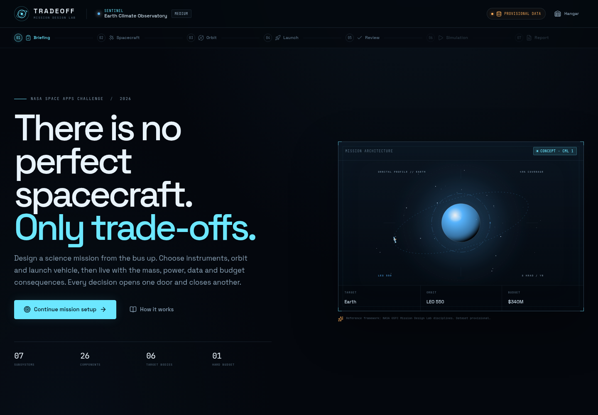
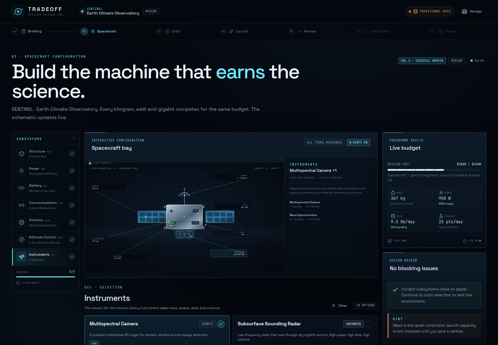
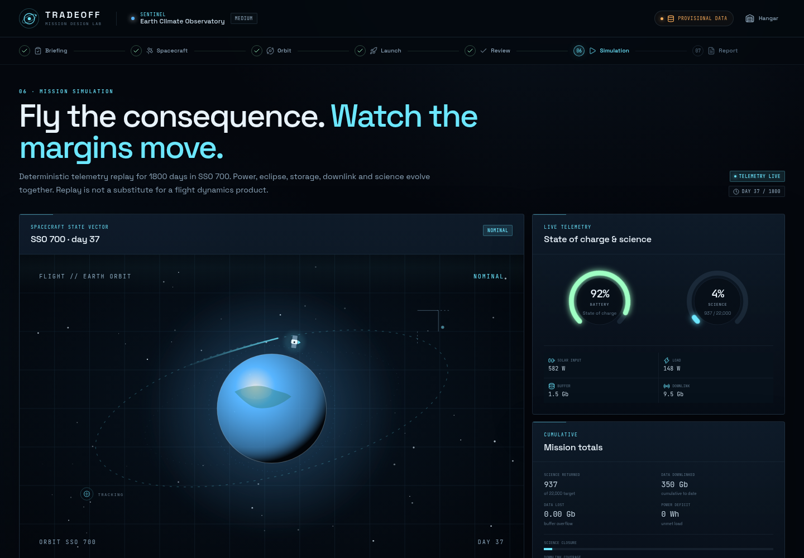
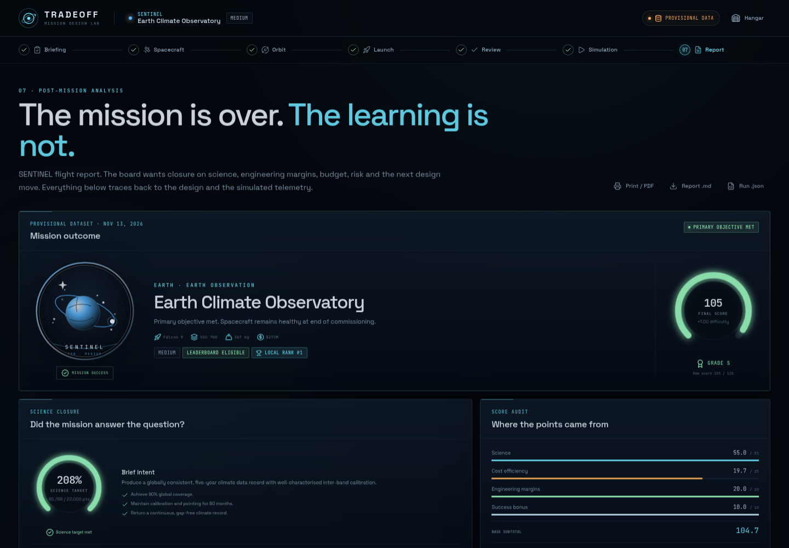
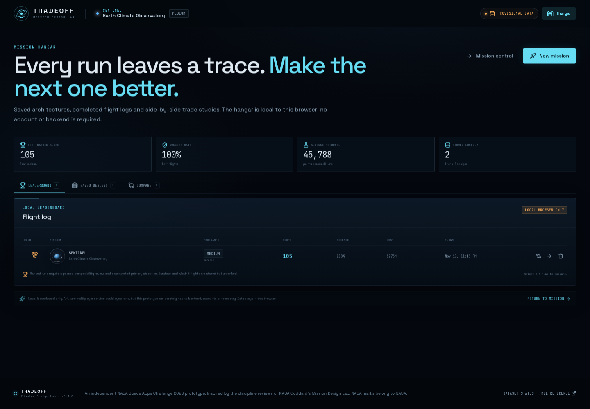
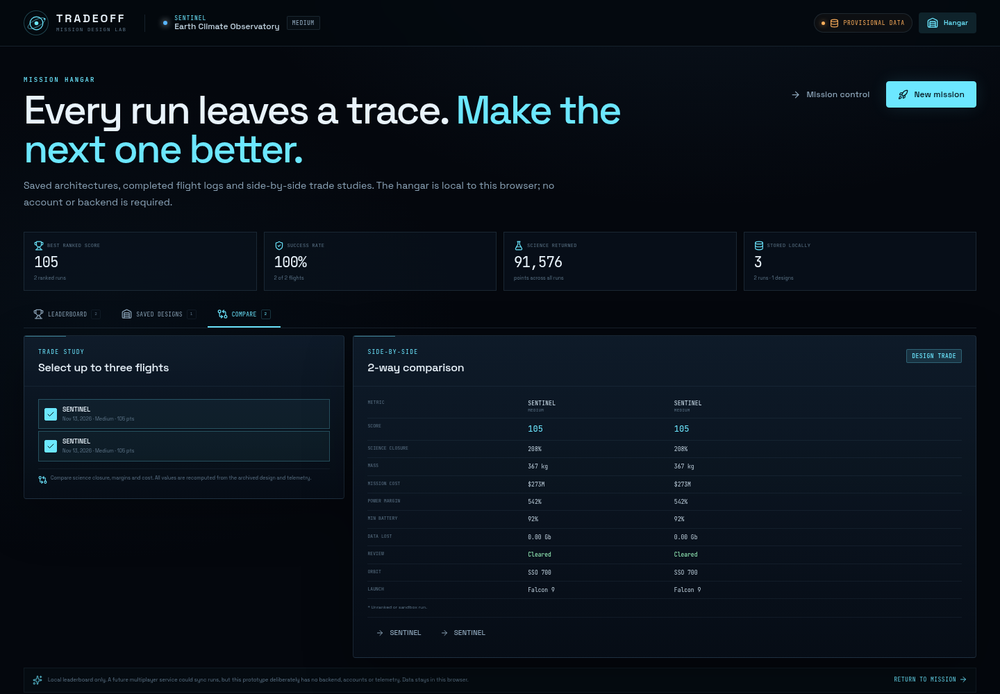

# TRADEOFF — Mission Design Lab

**There is no perfect spacecraft. Only trade-offs.**

TRADEOFF is a browser-based mission design game built for the **NASA Space Apps
Challenge 2026**. Choose a science brief, assemble a spacecraft, pick an orbit
and a launch vehicle, survive design review, fly a deterministic mission and
defend the result to the review board.

The game runs entirely in the browser with no account, backend or network
requirement. Missions, designs and leaderboard runs are stored in
`localStorage`.

> **Provisional dataset v0.3.0.** Component, orbit and launch values are
> gameplay-balanced estimates compiled from public mission literature. They are
> not flight-qualified and this is **not an official NASA product**. The official
> NASA Space Apps resource pack is the pending source of record; the drop-in
> contract is documented in [`docs/RESOURCE-INTEGRATION.md`](docs/RESOURCE-INTEGRATION.md).

## What you can do

- **Brief** — choose from six science missions across Earth, the Moon, Mars,
  Venus, Europa and an asteroid, each with required measurements, coverage,
  lifetime, budget, hazards and a real-mission analogue.
- **Build** — trade mass, power, data, volume, cost, radiation tolerance, slots
  and pointing across 25 components and 7 subsystems. The live schematic and
  budget rail update with every choice.
- **Orbit** — compare 15 orbits against coverage, eclipse, radiation,
  station-keeping and comms geometry. Download a NASA GMAT starting handoff.
- **Launch** — test mass, fairing envelope and programme cost across six launch
  vehicles. The rocket is treated as part of the design, not a checkout step.
- **Review** — get a NASA-MDL-style review: MEL, power/data/eclipse budgets,
  grouped gating checks, readiness score and a JPL-CML-inspired maturity badge.
- **Fly** — replay a deterministic 2D mission with live battery, buffer, science
  and power telemetry, scrubber, event log, charts and contingency states.
- **Analyse** — read a score audit, science closure, engineering margins,
  findings, next design move and flight-heritage notes. Export Markdown or JSON,
  or print the report to PDF.
- **Hangar** — keep completed runs and saved architectures, inspect a local
  leaderboard, and compare up to three completed runs side by side.
- **Share** — copy a URL-encoded design link; no account required.
- **Sandbox** — fly unranked what-if designs with relaxed compatibility. Physics
  and telemetry still respond to the design.

## Screenshots

| Briefing | Spacecraft bay |
| --- | --- |
|  |  |

| Flight replay | Post-mission report |
| --- | --- |
|  |  |

| Mission hangar | Side-by-side trade study |
| --- | --- |
|  |  |

## Run locally

Requirements: **Node.js 22+** and npm.

```bash
npm install
npm run dev
```

Open <http://localhost:5173>. The Vite dev server binds to `0.0.0.0` for mobile
testing on the same network.

### Production build

```bash
npm run build
npm run preview
```

The static output is in `dist/` and can be hosted on any static host (GitHub
Pages, Netlify, Cloudflare Pages, S3, an offline file server). No server-side
runtime is required.

### Scripts

| Command | Purpose |
| --- | --- |
| `npm run dev` | Start the Vite development server |
| `npm run build` | Type-check with `tsc --noEmit`, then build to `dist/` |
| `npm run preview` | Serve the production build |
| `npm test` | Run engine and data tests with Vitest |
| `npm run test:watch` | Watch mode for tests |
| `npm run data:check` | Validate the resource manifest, mappings and dataset badge |
| `npm run data:check:strict` | Release gate: fails while the official pack is pending |
| `npm run qa` | Headless Chrome smoke test of the full game loop (dev server must be running) |

## Game loop

1. **Briefing** — pick a mission and difficulty. Difficulty changes budget,
   advanced-hardware cost, power/data margins, science target, hints and score
   multiplier.
2. **Spacecraft** — install all six mandatory subsystems plus at least one
   instrument. The live rail shows mass, power, data, science, slots, lifetime
   and mission cost. Ground segment is always included.
3. **Orbit** — choose an allowed orbit. Compare coverage, eclipse duration,
   radiation, comms passes and station-keeping. Optional GMAT handoff.
4. **Launch** — choose a vehicle that can carry the mass and fit the stowed
   envelope to the target destination within budget.
5. **Review** — unresolved failures can still be flown as an unranked
   “what-if” simulation. The primary path requires a valid design.
6. **Simulation** — deterministic telemetry replay. The run auto-saves to the
   local hangar when it starts.
7. **Report** — score, science closure, findings, maturity, provenance and
   exports. Iterate on the same design or start a new mission.
8. **Hangar** — leaderboard, saved designs, run reports and three-way compare.

### Scoring

The score is deliberately auditable:

| Category | Maximum |
| --- | ---: |
| Science closure | 55 |
| Cost efficiency | 25 |
| Engineering margins | 20 |
| Success bonus | 10 |
| **Raw total** | **110** |

The difficulty multiplier is applied after the raw total. Cost efficiency
rewards budget headroom rather than cheapness alone. Margins reward mass, power
and downlink reserve. The success bonus requires both a valid design and a
completed science objective. Only ranked difficulties with a successful,
compatible run enter the leaderboard.

The fixed **$20M ground segment** covers ground station access, operations,
navigation and archive. It is a gameplay abstraction, not a NASA cost model.

## Architecture

```text
src/
├── data/          Typed reference data: bodies, components, orbits, vehicles,
│                  objectives, measurements, difficulty and dataset metadata
├── engine/        Pure design math, compatibility, simulation, scoring,
│                  maturity, storage, sharing, GMAT and report generation
├── state/         Reducer, context, persistence and step readiness
├── components/
│   ├── screens/   Briefing, builder, orbit, launch, review, flight, report, hangar
│   ├── builder/   Component cards, specs and interactive schematic
│   ├── visuals/   SVG orrery, flight track, body orbs, mission patches, rockets
│   ├── layout/    Top bar, stepper, footer, starfield, data-status modal
│   └── ui/        Buttons, panels, badges, meters, gauges, charts, modal, toast
├── test/          Shared engine fixtures
└── styles.css     Design tokens, responsive layouts, reduced-motion and print
```

Key properties:

- **No backend.** All state is local. Share links encode the design, not the run.
- **Deterministic simulation.** A design always produces the same telemetry;
  mission run IDs vary, but simulation values do not use `Math.random()`.
- **Auditable scoring.** Score components are shown in the report and exported
  Markdown.
- **Typed resource boundary.** Official data replaces typed data modules, not UI
  components.
- **Print-first report.** The report has dedicated print styles and a NASA-style
  disclaimer.
- **Responsive.** Desktop review boards, tablet layouts and 390 px mobile layouts
  are covered. Motion respects `prefers-reduced-motion`.

## Official resources and provenance

The game integrates references from several NASA sources, with different levels
of integration:

| Resource | Use |
| --- | --- |
| NASA GSFC Mission Design Lab | Review discipline: MEL, power/data budgets, orbit, launch, risk, cost |
| JPL Concept Maturity Levels paper | Game adaptation of CML 1–4, labelled as adapted |
| NASA *Design and Develop Science Missions* | Mission segment and review framing |
| NASA *CubeSat 101* | Small-spacecraft process, AIT and risk language |
| NASA `mission-viz` | Evaluated for future 3D visualization; SVG remains the fallback |
| Webb *Build It Yourself* | Trade-off inspiration and real-mission analogue framing |
| NASA GMAT | Downloadable starting script / JSON handoff, not embedded |

Full citations, field mappings, licensing notes and the release checklist are in
[`docs/RESOURCE-INTEGRATION.md`](docs/RESOURCE-INTEGRATION.md). The source
register and validation gate are in
[`resources/manifest.json`](resources/manifest.json) and
[`scripts/check-resources.mjs`](scripts/check-resources.mjs).

### Drop in the official pack

1. Place files in `resources/incoming/`.
2. Register them in `resources/manifest.json`.
3. Map and replace values in `src/data/`.
4. Update the status in `src/data/dataset.ts` and the manifest together.
5. Run `npm run data:check:strict && npm test && npm run build`.

The UI will continue to show the provisional badge until that status changes.

## Testing and QA

```bash
npm test
npm run build
npm run data:check
```

The Vitest suite covers:

- dataset uniqueness and cross-references;
- reference-design totals, mass, cost and ground segment;
- missing subsystems, payload relevance and sandbox relaxation;
- deterministic simulation success, telemetry length and daily indexing;
- scoring audit and leaderboard eligibility;
- GMAT script generation and JSON fallback;
- Markdown/JSON report exports;
- share-link round trips, partial designs and malicious/unknown IDs.

For a browser-level smoke test, start `npm run dev` and run `npm run qa` with
Chrome or Chromium installed. Set `CHROME_PATH` if it is not in a standard
location. The script drives briefing → builder → orbit → launch → review →
flight → report → hangar, exercises save, share, compare and reload persistence,
checks mobile overflow and browser console errors, and refreshes the screenshots
in `docs/screenshots/`.

## Known limits and next steps

- The official NASA resource pack is still pending; all numeric values are
  provisional.
- No backend, accounts, realtime multiplayer or global leaderboard. Local
  leaderboard and URL sharing work offline.
- GMAT downloads are validated structurally, not inside a GMAT installation.
- `mission-viz` 3D is deferred; the SVG orrery and flight track are the shipping
  visualization.
- Mission patches are generated procedural art, not official NASA insignia.
- Cost, mass and launch values are rounded for play and must not be used for real
  mission planning.

## Credits

Built as an independent NASA Space Apps Challenge 2026 prototype. Thanks to the
NASA mission teams, the GSFC Mission Design Lab, the JPL CML authors, the NASA
CubeSat Launch Initiative, the NASA `mission-viz` team and the GMAT team whose
public work informed the simulation and review framing.

**TRADEOFF is not an official NASA product.**
